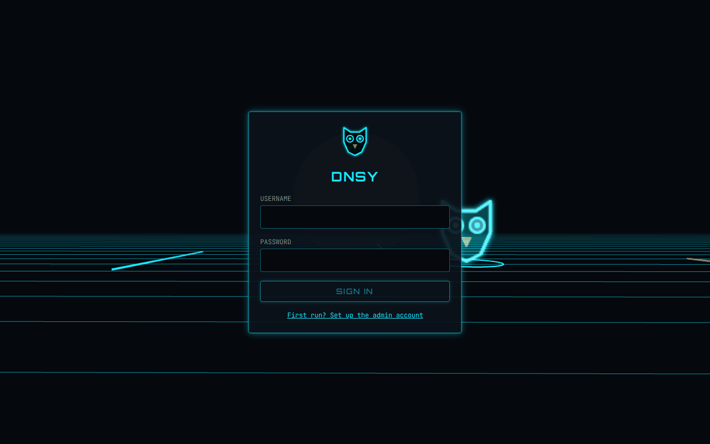
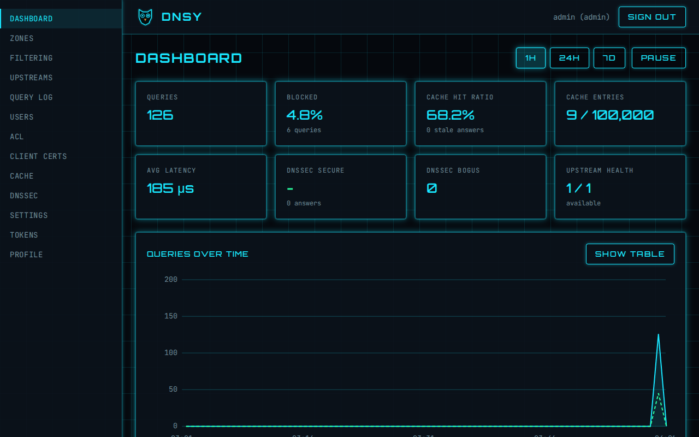
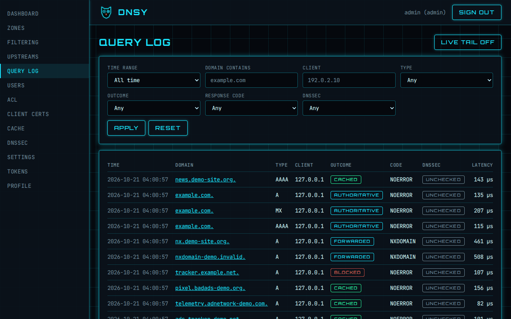
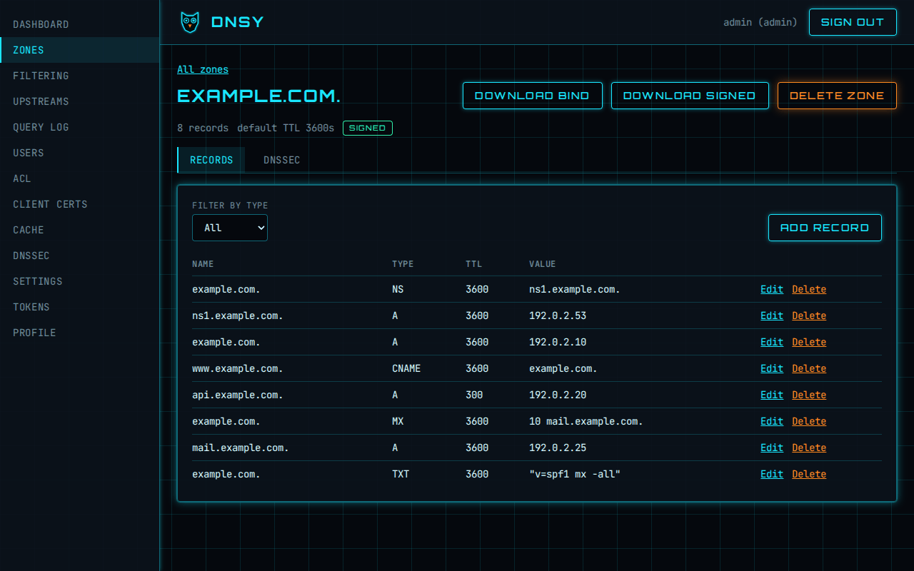
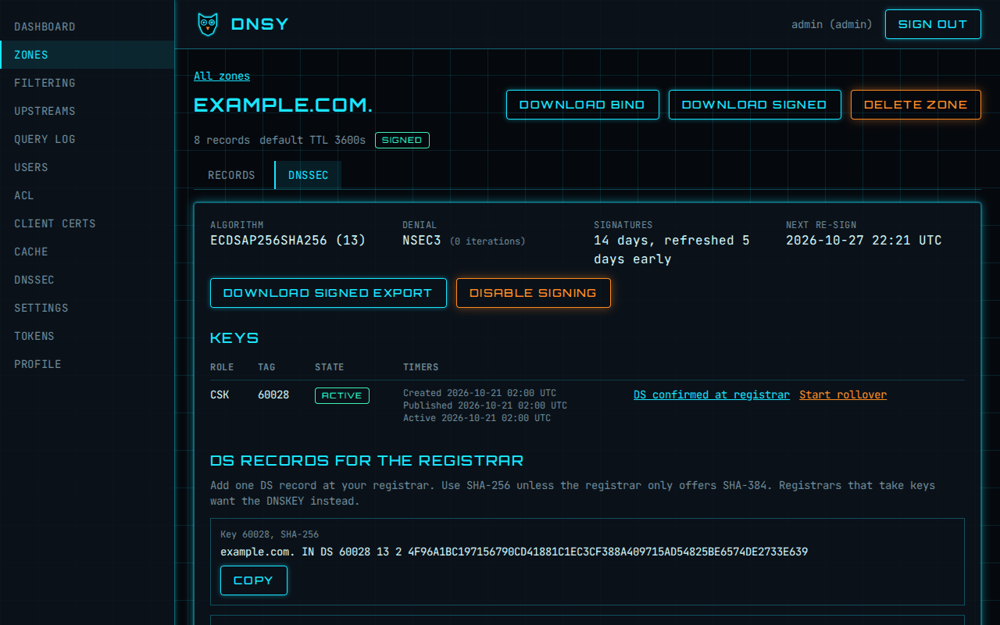
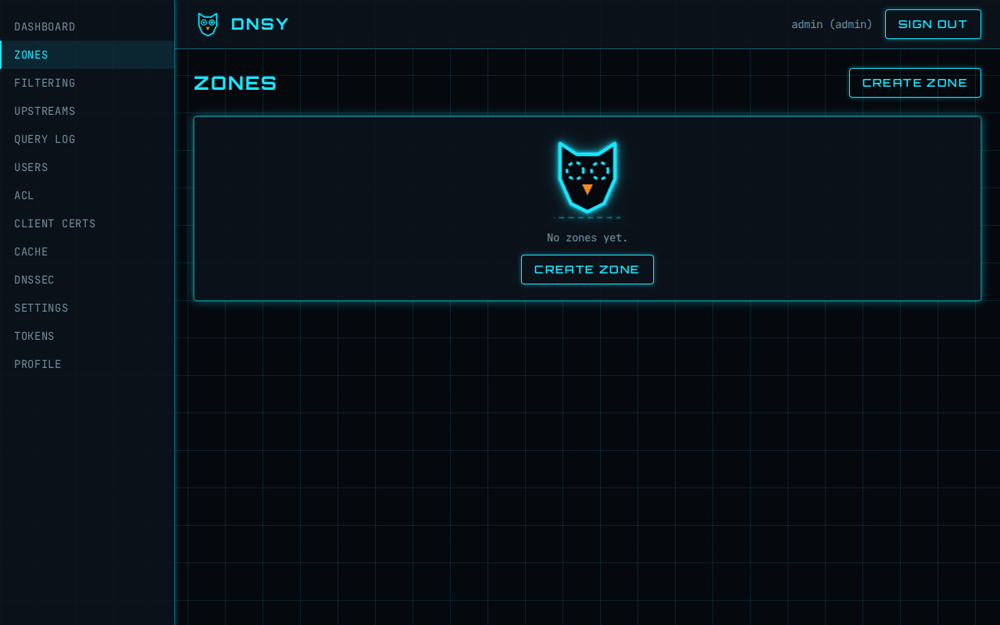
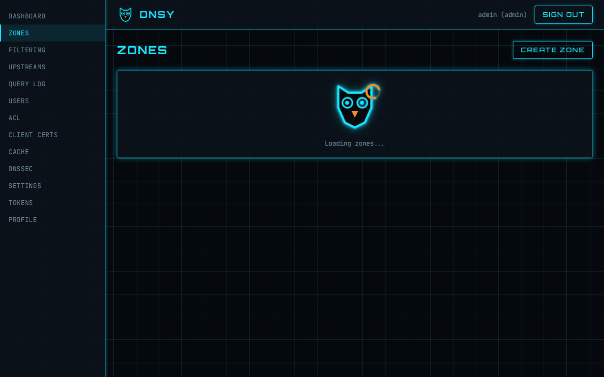

<div align="center">


**A fast, private DNS server in a single Rust binary.**

<!--
Badges: enable these once the pipelines exist (final wave, DNSY-64 to DNSY-67). They are
commented out on purpose so the README does not show broken images today.

[](https://github.com/repsyio/dnsy/actions/workflows/ci.yml)
[](https://github.com/repsyio/dnsy/actions/workflows/e2e.yml)
[](https://github.com/repsyio/dnsy/releases)
-->
[](LICENSE)



</div>

DNSY answers for your own zones, forwards everything else to the upstream resolvers you choose
with caching, load balancing and DNSSEC validation, filters ads and unwanted domains, and serves
plain DNS, DNS over TLS (with mTLS) and DNS over HTTPS (with tokens). You run it as one
binary with an embedded SQLite database, and manage it through a REST API or a Tron-styled web UI
guarded by **Nox**, the owl. The DNS layer, including all of DNSSEC, is written in this repository:
no DNS library, only `ring` for raw crypto primitives.

## Features

- **DNS over UDP and TCP** with EDNS0, Extended DNS Errors, truncation and TCP pipelining.
- **DoT with mTLS** (off, optional or required client certificates, with an allowlist) and
  **DoH with tokens** (header or path token, GET and POST, HTTP/2).
- **DNSSEC validation and signing**: a chain-of-trust validator (strict, permissive or off,
  negative trust anchors) and zone signing with ECDSA P-256 or Ed25519, NSEC or NSEC3, automatic
  re-signing, key rollover and DS records for your registrar.
- **Caching** with negative caching, serve-stale, prefetch, TTL clamping and per-key flush.
- **Proxy and load balancing** across upstream groups with health checks and routing.
- **Blocklists and ACL**: hosts, domain and adblock lists, custom allow/block rules, client ACL,
  per-client rate limiting, response-IP policy.
- **Logging and stats**: a searchable query log with live tail, rollups and a dashboard.
- **REST API and OpenAPI 3.1** for everything the UI does.
- **Tron-style web UI** with a 3D login scene, a dashboard, a zone editor with a DNSSEC tab, the
  query log and admin pages.
- **JSON zone files** with hot reload, **BIND export** (also signed), and an embedded **SQLite**
  database for users, tokens, rules, keys and the log.
- **One TOML config file**, overridable per key from the environment, validated with
  `dnsy config check`.

## Screenshots

| | |
| --- | --- |
|  |  |
|  |  |

<details>
<summary>Nox, the mascot: empty and loading states</summary>

| | |
| --- | --- |
|  |  |

</details>

## Quickstart

DNSY is built from source for now; release binaries come with the release pipeline.

**1. Build.** You need a Rust toolchain (pinned in `rust-toolchain.toml`). `just build` also builds
the web UI and embeds it (it needs node and pnpm); without them
`cargo build --release -p dnsy` gives the same server with the UI paths answering 404.

```sh
git clone https://github.com/repsyio/dnsy && cd dnsy
just build
export PATH="$PWD/target/release:$PATH"
dnsy version
```

**2. Configure.** A minimal configuration on a high port (no root needed) with one local zone.
The complete annotated example is [`examples/dnsy.toml`](examples/dnsy.toml).

```sh
mkdir -p dnsy-demo/zones dnsy-demo/data
cat > dnsy-demo/dnsy.toml <<'EOF'
[server]
data_dir = "./dnsy-demo/data"

[dns]
udp = ["127.0.0.1:5353"]
tcp = ["127.0.0.1:5353"]

[zones]
dir = "./dnsy-demo/zones"

[resolver]
upstreams = ["1.1.1.1:53", "9.9.9.9:53"]
EOF
cat > dnsy-demo/zones/lab.example.json <<'EOF'
{
  "schema": 1,
  "origin": "lab.example.",
  "default_ttl": 300,
  "soa": {"mname": "ns1.lab.example.", "rname": "hostmaster.lab.example.",
          "serial": 1, "refresh": 7200, "retry": 3600, "expire": 1209600, "minimum": 300},
  "records": [
    {"name": "@", "type": "NS", "value": "ns1.lab.example."},
    {"name": "ns1", "type": "A", "value": "127.0.0.1"},
    {"name": "nas", "type": "A", "value": "192.168.1.40"}
  ]
}
EOF
export DNSY_CONFIG="$PWD/dnsy-demo/dnsy.toml"
dnsy config check
```

**3. First admin.** Create the admin from the command line (the password is printed once)...

```sh
dnsy user create admin --role admin
```

...or start the server with no users: it prints a one-time bootstrap code, and the login page's
"First run? Set up the admin account" link takes that code to create the first admin.

**4. Run.**

```sh
dnsy serve
```

The web UI and the API are on <http://127.0.0.1:5380> (`/healthz` and `/readyz` are the probes).

**5. Ask it** (in another terminal, with `PATH` and `DNSY_CONFIG` still set):

```sh
dig @127.0.0.1 -p 5353 nas.lab.example +short          # authoritative: 192.168.1.40
dig @127.0.0.1 -p 5353 cloudflare.com +dnssec          # forwarded and validated: flags include ad
dig @127.0.0.1 -p 5353 dnssec-failed.org               # SERVFAIL with EDE 9: validation caught a broken zone
dnsy zone export lab.example                           # the zone as BIND text
```

**6. Encrypted DNS and tokens.** Set `listen`, `cert` and `key` under `[dot]` and `[doh]` (see
[DoT](docs/book/src/dot.md) and [DoH](docs/book/src/doh.md)), create a token, and query:

```sh
dnsy token create --user admin --name laptop --scope dns:query     # the secret is printed once
dig +tls @dns.example.com nas.lab.example +short
curl -H "Authorization: Bearer $TOKEN" \
  "https://dns.example.com/dns-query?dns=AAABAAABAAAAAAAAB2V4YW1wbGUDY29tAAABAAE"   # example.com A, binary reply
```

## Architecture

```text
 clients                    dnsy (one process)                         upstreams
                  +---------------------------------------+
 UDP/TCP :53 ---> |  dnsy-server  listeners (UDP TCP DoT DoH)
 DoT     :853 --> |        |                                |
 DoH     :443 --> |        v                                |
                  |  dnsy-engine  pipeline: sanity, ACL, rate limit, filter,
                  |        |      local zones, cache, validation, shaping
                  |        |---> dnsy-zone      JSON zones, signing, lookup
                  |        |---> dnsy-filter    blocklists, ACL, rate limit
                  |        '---> dnsy-resolver  cache, load balancing ----> 1.1.1.1 ...
                  |                  '--- dnsy-dnssec  validation          9.9.9.9 ...
                  |  dnsy-observe  query log + stats   dnsy-auth  users, tokens
                  |  dnsy-store    SQLite              dnsy-config  TOML schema
 browser, curl -> |  dnsy-api      REST + OpenAPI + embedded web UI :5380
                  +---------------------------------------+
```

Every transport feeds the same pipeline, and exactly one query-log event is emitted per request.
See [Architecture](docs/book/src/architecture.md).

## Project layout

```text
crates/       dnsy-core, -proto, -dnssec, -config, -store, -auth, -observe, -zone,
              -resolver, -filter, -engine, -server, -api, and the dnsy binary
web/          Angular app (the web UI) and its Playwright browser tests (web/e2e)
tests/e2e/    end-to-end suites that drive the real binary over the wire
openapi/      the generated OpenAPI document (openapi/dnsy.json)
branding/     logo, mark, favicon, the Nox mascot SVGs, design tokens and fonts
docs/         the mdBook (docs/book), the landing page, specs and plans
examples/     dnsy.toml, the annotated example configuration
scripts/      coverage gates, SVG check, demo and screenshot tooling
```

## Documentation

- The book: <https://dnsy.dev/docs/> (planned; build it locally with `just docs`, output in `target/site/`)
  with install, configuration, zones, DNSSEC, filtering, DoT, DoH, REST API, operations,
  troubleshooting and more. Sources are in [`docs/book/src`](docs/book/src/SUMMARY.md).
- API reference: <https://dnsy.dev/api/> (planned). The OpenAPI document is checked in as
  [`openapi/dnsy.json`](openapi/dnsy.json), and a running server serves it at `/api/openapi.json`.
  See [API reference](docs/book/src/api-reference.md).
- [Changelog](CHANGELOG.md).

## Development

```sh
just ci        # fmt, clippy (pedantic), cargo-deny, tests, coverage gates, web, e2e, browser e2e
just docs      # rustdoc and the book into target/site/
```

Read [CONTRIBUTING.md](CONTRIBUTING.md) and [AGENTS.md](AGENTS.md) first.

## Security

Report vulnerabilities privately to <security@repsy.io>; see [SECURITY.md](SECURITY.md) and the
[threat model](docs/book/src/security.md). Do not open public issues for vulnerabilities.

## License

[Apache-2.0](LICENSE).
