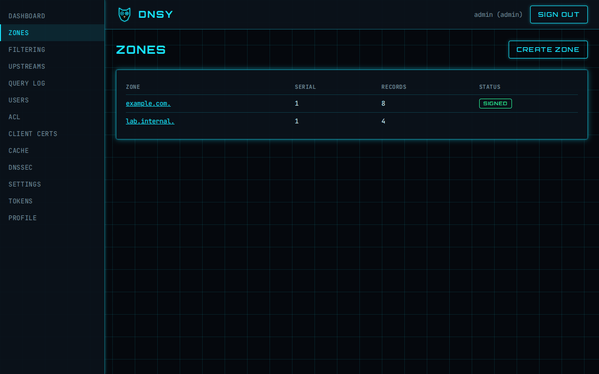
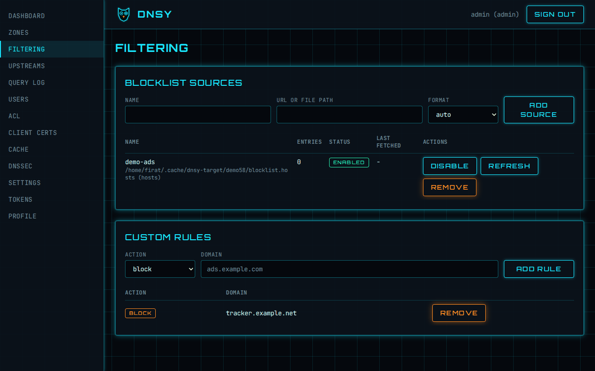

# Web UI

The web interface is an Angular single-page app in `web/`. It is built to `web/dist/dnsy/browser`
and embedded into the binary by `dnsy-api` (feature `embed-ui`), which serves it from `/` with a
single-page-app fallback.

This page covers the shell, the dashboard, the query log, the zones pages, the admin pages
(filtering, ACL, upstreams, client certificates, cache, settings) and the users, tokens and
profile pages.

## Screenshots

Taken at 1280 px from a seeded demo with Playwright (`scripts/demo/run.sh`, `scripts/demo/capture.mjs`).







Nox in an empty list and while loading:


## Stack

- Angular (standalone components, signals, zoneless change detection, esbuild `application` builder),
  strict TypeScript and strict templates.
- Tailwind CSS, configured with the DNSY design tokens (`branding/tokens.css`) in `src/styles.css`.
- angular-eslint and Prettier for linting, Vitest through `ng test` for unit tests, Playwright
  (`web/playwright.config.ts`, tests in `web/e2e/`) for browser tests.
- pnpm, with the lockfile checked in.

## Tron Legacy theme

Near-black background with a cyan grid, cyan glow as the primary accent, orange for danger,
glowing panels, Orbitron headings and JetBrains Mono body text. Colours, fonts and glows come from
`branding/tokens.css`; the build bundles the self-hosted woff2 fonts (no CDN). The mark and Nox
mascot SVGs are copied from `branding/` into `web/public/` by `pnpm sync:branding` (run by
`pnpm build` and `pnpm start`; `public/` is generated and not committed).

## Strict CSP

The API sends `default-src 'self'` with no inline styles or scripts, so the build must not emit
any. `angular.json` sets `optimization.styles.inlineCritical: false` (no inline critical CSS and no
`onload` handlers) and fonts are not inlined. Rules for UI code:

- Do not use component `styles`/`styleUrl`; Angular would inject `<style>` elements at runtime,
  which the CSP blocks. Style with Tailwind classes or the global stylesheet.
- No inline `style="..."` attributes, no `data:` URIs, no inline event handler attributes.

## Routing and auth

All pages are lazy-loaded (`loadComponent`). `/login` is public; everything else lives under the
layout shell (sidebar navigation, header with the mascot mark) behind `authGuard`, which asks
`GET /api/v1/auth/me` once and redirects to `/login?redirect=<url>` when unauthenticated. Unknown
paths render the 404 page.

The session is an HttpOnly cookie. `apiInterceptor` (same-origin `/api/` calls only):

- adds `X-CSRF-Token` from the `dnsy_csrf` cookie on unsafe methods (double submit);
- maps failures to a typed `ApiError`, carrying the RFC 9457 problem document when the body is
  `application/problem+json`;
- on a 401 clears the session and navigates to `/login`.

`ApiService` is a thin `HttpClient` wrapper rooted at `/api/v1`.

## API types

`web/src/app/api/schema.d.ts` is generated from `openapi/dnsy.json` with `openapi-typescript` and
checked in. Regenerate after an API change with `just openapi` followed by `just web-types`;
`just web` fails when the file is stale.

## Commands

| Command                | What it does                                                                                                                                                                   |
| ---------------------- | ------------------------------------------------------------------------------------------------------------------------------------------------------------------------------ |
| `just web`             | `pnpm install --frozen-lockfile`, lint (`ng lint` and Prettier), unit tests with coverage (>= 80%), production build, types drift check. Skipped when node or pnpm is missing. |
| `just web-types`       | regenerate the API types                                                                                                                                                       |
| `cd web && pnpm start` | dev server on `http://localhost:4200` (proxy API calls to a running dnsy yourself)                                                                                             |

The production build enforces an initial bundle budget of 300 kB (warning) and 400 kB (error), raw.
The three.js login scene (DNSY-46) must stay in a lazy chunk.

## Mascot components

`web/src/app/shared/mascot/` holds six standalone components for the Nox states, each with the
same inputs:

| Component                 | Selector                | Used for                            |
| ------------------------- | ----------------------- | ----------------------------------- |
| `MascotLoadingComponent`  | `dnsy-mascot-loading`   | route navigation, pending data      |
| `MascotEmptyComponent`    | `dnsy-mascot-empty`     | empty lists, placeholder pages      |
| `MascotErrorComponent`    | `dnsy-mascot-error`     | failed requests                     |
| `MascotSuccessComponent`  | `dnsy-mascot-success`   | completed actions                   |
| `MascotOfflineComponent`  | `dnsy-mascot-offline`   | browser offline banner in the shell |
| `MascotNotFoundComponent` | `dnsy-mascot-not-found` | the 404 page                        |

Inputs (signals): `size` (`sm`, `md`, `lg`; default `md`), `message` (caption; each state has a
default) and `action` (label of an optional button; the `actionClick` output fires on click).

```html
<dnsy-mascot-error
  message="Could not load zones."
  action="Retry"
  (actionClick)="reload()"
/>
```

The art is drawn inline from `branding/mascot/nox-*.svg` so the global keyframes in
`shared/mascot/mascot.css` (imported by `styles.css`) can animate its parts under the strict CSP:
bobbing, scanning pupils, a spinner, marching dashes, an error flash, a drawn check mark. All glow
uses `drop-shadow` with the DNSY tokens. There are no JavaScript animation libraries.

Accessibility: the SVG has `role="img"` and a distinct `aria-label` per state; the caption is a
live region (`status` or `alert`) for loading, success, offline and error. With
`prefers-reduced-motion: reduce` every animation is removed (CSS media query, plus a `nox-static`
class driven by `matchMedia`) and Nox keeps its static pose.

The shell shows the loading mascot during route navigation and the offline mascot when the browser
goes offline. A gallery of all states and sizes lives at `/dev/mascot` (behind login). It is only
registered when Angular runs in dev mode, so production builds answer with the 404 page.

## Login page

`/login` (`web/src/app/features/login/`) is a three.js scene with the sign-in form overlaid.

- **Scene:** a cyan light-grid floor receding to an orange horizon glow, light-cycle trails, the
  Nox mascot as an additive hologram (`mascot/nox-idle.svg` as a sprite texture) over a ring,
  slow camera drift and pointer parallax. Pixel ratio is capped at 2.
- **Loading:** `three` (pinned, named imports only) lives in `login-scene.ts`, which the page
  imports dynamically after first render, so it is its own lazy chunk and not part of the initial
  bundle. The render loop runs in `requestAnimationFrame` through `setAnimationLoop`, outside
  change detection.
- **Fallback:** with `prefers-reduced-motion: reduce` or when WebGL cannot create a context (or the
  chunk fails to load) the page shows a static SVG perspective grid and never loads three.js. The
  decision is `decideScene` in `scene-support.ts`; the form behaves the same either way.
- **Lifecycle:** rendering pauses while the tab is hidden; on destroy (or when reduced motion is
  switched on) geometries, materials, textures and the renderer are disposed and the GL context
  is released.
- **CSP:** works under `default-src 'self'`: no workers, blobs, `data:` URIs, eval or inline
  styles; the mascot texture is a same-origin file.
- **Form:** labelled username and password fields, errors in a `role=alert` region, the Nox
  loading mascot while the request runs. A 429 locks the form and counts down `retry_after_secs`.
- **First admin:** the API has no "no users yet" endpoint, so the page cannot detect it. The link
  "First run? Set up the admin account" switches the form to setup mode (one-time code printed at
  server start, username, password of 8+ characters), which calls `POST /auth/bootstrap` and then
  signs in. A 409 (admin exists) returns to the sign-in form.

## Zones and records

Code lives in `web/src/app/features/zones/`. Routes: `/zones` (list) and `/zones/:name` (detail).

- **List**: one row per zone with serial and record count, a `signed` badge when DNSSEC signing is
  enabled and a `load error` badge (with the message) when the zone file on disk is not being
  served. Loading, empty and error states use the Nox mascot components; the error state has a
  retry button. "Create zone" opens a dialog (name, apex name servers, SOA, TTLs) and, on success,
  opens the new zone.
- **Detail**: zone header, record table (50 per page, filter by type), "Download BIND" and, for
  signed zones, "Download signed" (`GET /zones/{name}/export?signed=...`, saved as
  `<zone>.zone` / `<zone>.signed.zone`). "Delete zone" asks you to type the zone name.
- **Records**: add and edit open an inline form; delete asks for confirmation. Types are A, AAAA,
  NS, CNAME, PTR, MX, TXT, SRV and CAA. The form validates the name, the TTL (whole seconds,
  empty means the zone default) and the value for the selected type (for example an IPv4 address
  for A, `<preference> <host>` for MX, four fields for SRV) before anything is sent. Server-side
  rejections (409, 422) are shown in the form.
- **Concurrency**: the zone `ETag` from every read and write is sent back as `If-Match` on
  writes. A 412 means the zone changed elsewhere: nothing was written, and a banner offers
  "Reload latest" (discard the edit and re-read) or "Overwrite anyway" (repeat the write with
  `If-Match: *`).
- **Tabs**: the detail page has a tab list with the Records and DNSSEC tabs (see
  [DNSSEC tab](#dnssec-tab)).

Accessibility: every control has a label, dialogs trap focus, close on Escape and return focus to
their opener, table actions carry descriptive `aria-label`s, and errors are announced through
`role="alert"`. Forms collapse to one column and tables scroll horizontally below 640 px, so the
pages work at 360 px.

## Admin pages

Each page is its own lazy-loaded folder under `web/src/app/features/` (`filtering`, `acl`,
`upstreams`, `certs`, `settings`, `cache`) with a typed service over `ApiService`. All of them use
the Nox mascot components for loading, empty and error states (the error state has a retry button),
confirm every destructive action in a focus-trapping dialog, label every control, announce errors
through `role="alert"` and collapse to one column with horizontally scrolling tables, so they work
at 360 px. Server rejections (409, 422) are shown next to the form that caused them.

| Route           | Folder      | What it does                                                                                    |
| --------------- | ----------- | ----------------------------------------------------------------------------------------------- |
| `/filtering`    | `filtering` | Blocklist sources and custom block/allow rules, see [Filtering](filtering.md#web-ui)            |
| `/acl`          | `acl`       | CIDR allow/refuse/drop rules (IP blocking) and the per-client rate limit                        |
| `/upstreams`    | `upstreams` | Upstream groups: strategy, members, add/remove, health                                          |
| `/client-certs` | `certs`     | DoT mutual-TLS fingerprint allowlist with labels and expiry                                     |
| `/cache`        | `cache`     | Live cache statistics, flush by name (optionally with subdomains) and flush everything          |
| `/settings`     | `settings`  | Block mode, per-client rate limit, query log retention, cache TTL clamp, serve-stale, prefetch |

- **ACL**: the address field accepts IPv4 or IPv6, with or without a prefix length, and is
  validated in the browser (`cidr.ts`) before the request is sent; the server validates again. The
  default action is shown read-only. Rules that match a client certificate (created through the
  API) are listed and can be removed.
- **Upstreams**: members show an up/down badge, latency and consecutive failures from
  `GET /upstream-groups/{name}/health`; when that endpoint is unavailable (503) the member shows
  "unknown". Changing the strategy sends the group back with its current members, weights and
  domains.
- **Client certificates**: the fingerprint is normalised (colons, spaces, case) and must be 64 hex
  digits; the optional expiry is the end of the chosen day in UTC. Entries can be disabled without
  removal. The certificate itself is never uploaded, so there is no show-once secret.
- **Cache**: statistics refresh every 5 seconds and stop when the page closes; if a refresh fails
  the last values stay on screen with a warning. "Flush entire cache" always opens a confirmation
  dialog first; flushing a single name reports how many entries were removed.
- **Settings**: one form, one `PATCH /settings`. Numbers and the TTL clamp (minimum not above
  maximum) are checked locally; the server's validation message is shown in an alert under the
  form. The API exposes no secrets (tokens, passwords, keys), so the page has no fields for them.

## Dashboard

`/dashboard` (`web/src/app/features/dashboard/`) summarises the selected range, fetched in one go
from the stats API:

- **Tiles**: queries, blocked share, cache hit ratio (with stale answers), cache entries and
  capacity, average latency, DNSSEC secure share and bogus count, and upstream health (available
  members over all members of all groups). The cache, DNSSEC and upstream tiles degrade to `-` when
  their endpoint fails (for example no cache is running); the others are required.
- **Range selector**: `1h` (1 minute buckets), `24h` (15 minutes, the default) and `7d` (2 hours).
- **Chart**: queries per bucket as an area line with the cache-answered share overlaid, drawn as
  plain SVG (`chart.ts`). Axes scale to the data (rounded up to 1, 2 or 5 times a power of ten) and
  quiet buckets are zero-filled. No inline styles are used, so the strict CSP holds. The SVG has a
  text alternative (title with total and peak) and a "Show table" toggle that renders every bucket as
  a table.
- **Top lists**: top domains, top blocked and top clients (10 each) with proportional bars.
- **Auto-refresh**: every 30 seconds, with a Pause/Resume button. Switching range reloads at once and
  discards responses for a range that is no longer selected.
- **States**: the loading, empty (no queries in the range) and error (with Retry) mascots; an alert
  banner when `GET /dnssec/status` reports an untrusted clock (validation suspended).

The layout is a two-column tile grid that grows to four columns, and a single column of lists below
the `lg` breakpoint, so it works at 360 px.

## Query log

Code lives in `web/src/app/features/query-log/`; route `/query-log`.

- **Filter bar**: time range (presets or a custom from/to), domain substring, client, query type,
  outcome, response code and DNSSEC status. Outcome is the answer source: blocked, cached, stale,
  forwarded, refused, authoritative or error. Filters are sent on Apply and cleared by Reset; empty
  filters are left out of the request (`toQuery` in `query-log.model.ts`).
- **Table**: newest first, 100 rows per request, "Load more" follows the API's `next_cursor`
  (keyset pagination, so rows arriving meanwhile do not shift pages). Rows are deduplicated by id.
  Client, response code and latency columns hide on narrow screens; the page works at 360 px.
- **Badges**: DNSSEC status has a lock in `--dnsy-secure` for secure, a warning mark in
  `--dnsy-bogus` for bogus and muted text for insecure, unchecked and indeterminate. Stale answers
  carry an orange `Stale` tag, blocked, refused and error answers use the bogus colour.
- **Detail drawer**: the domain in each row is a button that opens a side drawer with every field
  the API returns: time, client, principal, transport, type, response code, source and upstream
  or blocklist name, latency and DNSSEC status. Escape closes it, focus stays inside and returns
  to the row. The log record does not carry answer data or extended DNS errors, so the drawer
  does not show them.
- **Live tail**: the toggle opens `GET /api/v1/querylog/stream` with `EventSource` (same-origin,
  authenticated by the session cookie) using the applied filters, without the time range. New rows
  are placed on top and the table keeps at most 1000 rows. Pause keeps the connection but holds
  new rows (up to 500, a counter shows how many) until Resume. A `lagged` event shows a notice that
  rows were skipped. When the connection drops the page reconnects with exponential backoff (1 s,
  doubling, capped at 30 s; reset once a connection opens). Viewers cannot tail (the API needs
  operator or admin), so the toggle is disabled for them.
- **States**: loading, empty and error use the Nox mascot components; a failed "Load more" shows
  an inline alert and keeps the rows.
- **Quick actions**: block and allow domain buttons are not present because the API has no such
  endpoint yet.

Controls are labelled, the table has a caption and column headers, and live status changes are
announced through `role="status"`.

## Users, tokens and profile

**Users** (`/users`, admins only; other roles are redirected to the dashboard and the nav entry is
hidden) lists accounts and lets an admin create a user, change a role, reset a password and delete
a user after a confirmation. The role and password changes end that user's sessions. You cannot
delete your own account from here. The API has no "disable" operation, so accounts are removed
rather than disabled.

**Tokens** (`/tokens`) manages the signed-in user's own API tokens:

- The scope picker only offers what the role allows (viewer: `api:read`; operator: everything but
  `admin`; admin: all). Expiry is optional.
- The secret is shown **once**, in a dialog with a warning and copy buttons (secret, and the full
  DoH URL when the token has `dns:query`). It lives only in that dialog's state: closing the dialog
  (button or Escape) drops it, and it is never written to `localStorage`, `sessionStorage` or logs.
  Lose it and you revoke the token and create a new one.
- The list shows scopes, last use, expiry and status; revoking asks for confirmation.
- DoH clients use `https://<host>/dns-query/<token>`; the page has a copy button for that form.
- Creating a token needs a cookie session; the API refuses it with a token.

**Profile** (`/profile`) shows the current user and how they signed in, changes the password (the
strength hints are advisory; the server enforces the 8 character minimum and keeps this session,
ending the others) and signs out. A wrong current password shows an error and does not sign you
out.

## Responsive layout

Below the `md` breakpoint (768 px) the sidebar is an off-canvas drawer: a Menu button in the header
opens it (`aria-expanded`, focus moves into the nav), Escape or the backdrop closes it and Escape
returns focus to the button. From `md` up the sidebar is always visible. The page content clips
horizontal overflow so wide tables scroll inside their own container; there is no horizontal page
scroll at 360 px.

## DNSSEC

The `dnssec` feature folder (`web/src/app/features/dnssec/`) has the zone's DNSSEC tab and the
validation page.

### DNSSEC tab

Open a zone and choose the **DNSSEC** tab. It reads `GET /zones/{name}/dnssec`.

- **Enable signing** (zone unsigned): pick the algorithm (ECDSAP256SHA256 or Ed25519, the only
  ones DNSY signs with), the key layout (one CSK or separate KSK and ZSK) and the denial of
  existence: NSEC3 (hides names, with optional hex salt, iterations and opt-out) or plain NSEC. The
  salt and iteration count are checked before anything is sent; non-zero iterations need an
  explicit tick because RFC 9276 advises 0. A confirmation dialog explains the registrar step:
  signing alone does not secure the zone until the DS is published at the registrar.
- **Disable signing**: the dialog says to remove the DS at the registrar first (otherwise
  validating resolvers return SERVFAIL for the zone) and asks you to type the zone name.
- **Keys**: role, key tag, state (`generated`, `published`, `active`, `retired`, `removed`) and
  the timers present (created, published, active, retired, removed, DS confirmed), plus the
  algorithm, denial settings and the **next re-sign** time.
- **Rollover**: "Start rollover" on an active key opens a confirmation, then calls
  `POST .../keys/{id}/rollover`. A KSK or CSK rollover waits for the new DS: publish it at the
  registrar, then use "DS confirmed at registrar" on the new key.
- **Unencrypted keys**: when `keys_encrypted` is false a warning banner (`role="alert"`) tells you
  to set a key passphrase.
- **DS for the registrar**: DS records are listed SHA-256 first; "Copy for registrar (SHA-256)"
  copies that one, every record and DNSKEY has its own copy button. A blocked clipboard shows a
  message instead of failing silently.
- **Signed export**: "Download signed export" saves `<zone>.signed.zone`.

### DNSSEC validation page

The **DNSSEC** entry in the navigation (`/dnssec`) shows and changes validation at run time
(`GET`/`PATCH /settings/dnssec`, counters from `GET /dnssec/status`).

- **Mode**: `strict` (recommended; bogus answers become SERVFAIL), `permissive` (validated and
  logged, bogus answers still returned) or `off`. Choosing a weaker mode asks for confirmation and
  says what it exposes you to. Changes are not saved to the configuration file.
- **Negative trust anchors**: names at and below which validation is skipped (RFC 7646). The API
  stores names only, so there is no expiry: remove an entry when the zone is fixed. A name is
  checked and lowercased before it is sent.
- **Trust anchors**: read-only table (zone, kind, key tag, algorithm, digest); they come from the
  configuration.
- **Counters**: secure and bogus answers and signed zones for the status window, and a banner when
  the clock is untrusted and validation is suspended.

Loading, error (with retry) and empty states use the mascot components; every control has a label,
errors use `role="alert"` and the pages work at 360 px.

## Known limits

- The query log drawer has no answer records or Extended DNS Error codes (the log does not store
  them) and there are no one-click block or allow buttons on log rows; use the Filtering page.
- Settings changed on the Settings and DNSSEC pages apply at once but are runtime-only (the
  per-client rate limit is saved); the configuration file wins after a restart.
